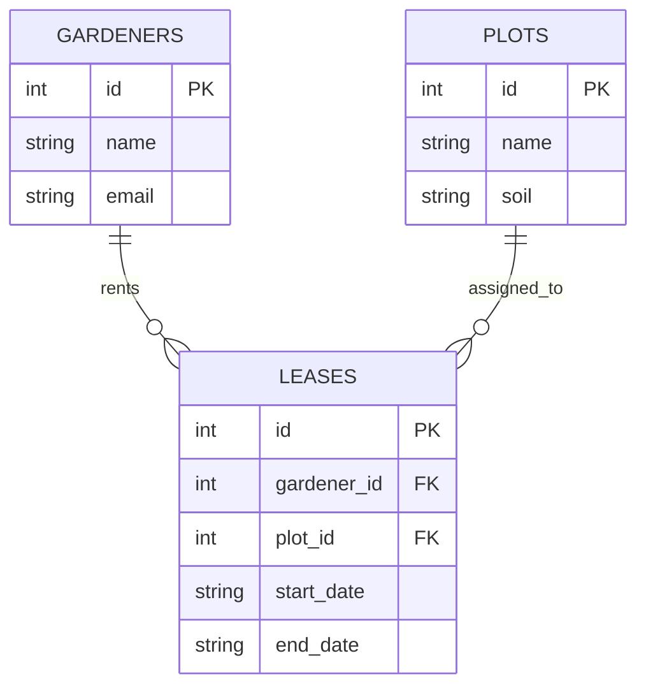

# 🌱 SeedShare Garden API

**BDF Group Assignment – Backend Development Fundamentals (Modules 1–3)**

- **Group:** YG-CSEDS2B-G02
- **Theme 17:** Garden Plots
- **Project Name:** SeedShare Garden API
- **Technology:** Node.js, Express.js, SQLite

---

## 📖 1. Project Overview

### Problem Statement

"Garden plots are given out by word of mouth. Two gardeners were promised the same plot, and nobody tracks the soil type. Please build us a system that fixes this."

### Solution

**SeedShare Garden API** is a RESTful backend application developed using Node.js, Express.js, and SQLite.

It solves the above problem by providing the following features:

1. Stores and manages garden plots along with their soil types.
2. Tracks soil types such as Loam, Clay, Sandy, and Silt.
3. Manages gardener registrations.
4. Manages garden leases using SQL JOIN operations.
5. Prevents double-booking of the same garden plot.
6. Implements pagination with strict validation using `page` and `limit` query parameters.

---

## 🚀 2. Quick Start and Setup

### Prerequisites

Install the following software before running the project:

- Node.js (Version 18 or higher)
- npm (Node Package Manager)
- Visual Studio Code
- Postman

### Installation

**Step 1: Open the project folder in VS Code.**

Open the terminal and execute:

```bash
cd seedshare-garden
```

**Step 2: Install dependencies.**

```bash
npm install
```

**Step 3: Start the server.**

```bash
npm start
```

**Step 4: Open the API.**

The server will run at:

```text
http://localhost:3000
```

---

## 🗄️ 3. Database Schema

The project uses an SQLite database named `seedshare.db`.

It contains three related tables:

1. `gardeners`
2. `plots`
3. `leases`

### Entity Relationship Diagram



### Table Descriptions

**1. Gardeners Table**

Stores gardener information.

- `id` – Unique gardener ID.
- `name` – Gardener's name.
- `email` – Unique email address.

**2. Plots Table**

Stores garden plot information.

- `id` – Unique plot ID.
- `name` – Garden plot name.
- `soil` – Soil type.

**3. Leases Table**

Stores lease information and connects gardeners with plots.

- `id` – Unique lease ID.
- `gardener_id` – Foreign key referencing gardeners.
- `plot_id` – Foreign key referencing plots.
- `start_date` – Lease starting date.
- `end_date` – Lease ending date.

Foreign key constraints are enabled to maintain database relationships.

---

## 🌐 4. API Endpoints

### A. Plot Endpoints (CRUD Operations)

The API supports Create, Read, Update, and Delete operations for garden plots.

| Method | Endpoint | Description | Status Codes |
|---|---|---|---|
| GET | `/plots` | Get all plots with pagination and search | 200, 400 |
| GET | `/plots/:id` | Get a single plot by ID | 200, 404 |
| POST | `/plots` | Create a new plot | 201, 400 |
| PUT | `/plots/:id` | Update an existing plot | 200, 400, 404 |
| DELETE | `/plots/:id` | Delete a plot | 200, 404 |

### B. The Twist: Pagination with Strict Validation

The project implements pagination to display garden plots in smaller groups.

The GET `/plots` endpoint accepts two query parameters:

- `page` – Specifies the current page number.
- `limit` – Specifies the number of records per page.

**Default values:**

- Page = 1
- Limit = 5

**Pagination Examples**

| Test | Endpoint | Expected Status |
|---|---|---|
| Test 1 | `/plots?page=1&limit=2` | 200 OK |
| Test 2 | `/plots?page=2&limit=2` | 200 OK |
| Test 3 | `/plots?page=0` | 400 Bad Request |

**Validation Rules:**

- Page must be an integer greater than 0.
- Limit must be a positive integer.
- Invalid pagination values return a 400 Bad Request response.

**Sample Error Response:**

```json
{
  "error": "Invalid page number: page must be an integer greater than 0"
}
```

**Pagination Response Structure:**

```json
{
  "total": 6,
  "page": 1,
  "limit": 5,
  "data": []
}
```

The `data` array contains the plot records for the requested page.

### C. Search by Soil Type

The API supports searching for garden plots based on soil type.

**Example:**

```http
GET /plots?soil=Loam
```

This returns plots whose soil type contains "Loam", without case sensitivity.

### D. JOIN Endpoint – Leases

The GET `/leases` endpoint uses SQL JOIN operations to combine information from three database tables.

It displays:

- Lease ID
- Gardener name
- Plot name
- Plot soil type
- Lease start date
- Lease end date

**SQL Query:**

```sql
SELECT
    leases.id AS lease_id,
    leases.start_date,
    leases.end_date,
    gardeners.name AS gardener_name,
    plots.name AS plot_name,
    plots.soil AS plot_soil
FROM leases
JOIN gardeners
    ON leases.gardener_id = gardeners.id
JOIN plots
    ON leases.plot_id = plots.id;
```

**Sample Response:**

```json
{
  "count": 1,
  "leases": [
    {
      "lease_id": 1,
      "start_date": "2026-03-01",
      "end_date": "2026-09-30",
      "gardener_name": "Alice Green",
      "plot_name": "North Patch",
      "plot_soil": "Loam"
    }
  ]
}
```

---

## 📮 5. Postman Collection

A Postman collection is included in the project for testing the API endpoints.

**Collection File:**

```text
SeedShare.postman_collection.json
```

### How to Import the Collection

1. Open Postman.
2. Click the **Import** button.
3. Select `SeedShare.postman_collection.json`.
4. Import the collection.
5. Open the required API request.
6. Click **Send** to execute the request.
7. Verify the response and HTTP status code.

### API Testing Screenshots

The following screenshots demonstrate the API operations:

| No. | Screenshot Filename | API Operation |
|---|---|---|
| 1 | `postman_get_api_response.png` | GET API Response |
| 2 | `postman_get_all_plots.png` | GET All Plots |
| 3 | `postman_get_leases.png` | GET Leases |
| 4 | `postman_post_create_plot.png` | POST Create Plot |
| 5 | `postman_put_update_plot.png` | PUT Update Plot |
| 6 | `postman_delete_plot.png` | DELETE Plot |

---

## 👥 6. Team Division of Work

The project is divided into six individual tasks.

| Part | Role | Description | Member |
|---|---|---|---|
| 1 | Server and Routes | Express server setup, middleware, root endpoint, HTTP status codes | Member 1 |
| 2 | Database | SQLite schema, tables, foreign keys, seed data | Member 2 |
| 3 | REST Endpoints | CRUD endpoints for plots and gardeners | Member 3 |
| 4 | Validation and Search | POST/PUT validation and soil search | Member 4 |
| 5 | Twist Rule | Pagination, offset, limit, and validation tests | Member 5 |
| 6 | Postman and README | Postman collection, documentation, and testing | Member 6 |

---

## 🎤 7. Three-Minute Demo Day Guide

### Minute 1: Introduction and Problem Solved (30 Seconds)

Introduce the project:

"Our project is SeedShare Garden API. It solves the problem of garden plot double-booking and helps maintain information about garden plots and their soil types."

Briefly explain the technologies:

- Node.js
- Express.js
- SQLite

### Minute 2: Demonstrate the Twist (60 Seconds)

Open Postman and demonstrate the three pagination tests.

**Test 1:**

```http
GET /plots?page=1&limit=2
```

Expected: 200 OK with the first two plots.

**Test 2:**

```http
GET /plots?page=2&limit=2
```

Expected: 200 OK with the next two plots.

**Test 3:**

```http
GET /plots?page=0
```

Expected: 400 Bad Request with a validation error.

Explain how pagination and strict validation work.

### Minute 3: JOIN Endpoint and CRUD Operations (60 Seconds)

Demonstrate the following:

1. **GET `/leases`** – Display gardener names and plot names together using JOIN.
2. **POST `/plots`** – Send incomplete data to demonstrate validation error (400).
3. **POST `/plots`** – Send valid data to demonstrate successful creation (201).
4. **PUT `/plots/:id`** – Demonstrate updating an existing plot.
5. **DELETE `/plots/:id`** – Demonstrate deleting a plot.

Conclude by explaining how the API manages garden plots and lease information.

---

## 🎯 8. Conclusion

The SeedShare Garden API provides a structured solution for managing community garden plots, gardeners, and leases.

By using Node.js, Express.js, and SQLite, the project demonstrates RESTful API development, database relationships, CRUD operations, SQL JOIN queries, input validation, search functionality, and pagination.

The project helps reduce plot allocation conflicts and provides an organized way to manage garden information.

**Project:** SeedShare Garden API  
**Group:** YG-CSEDS2B-G02  
**Theme:** 17 – Garden Plots

---
